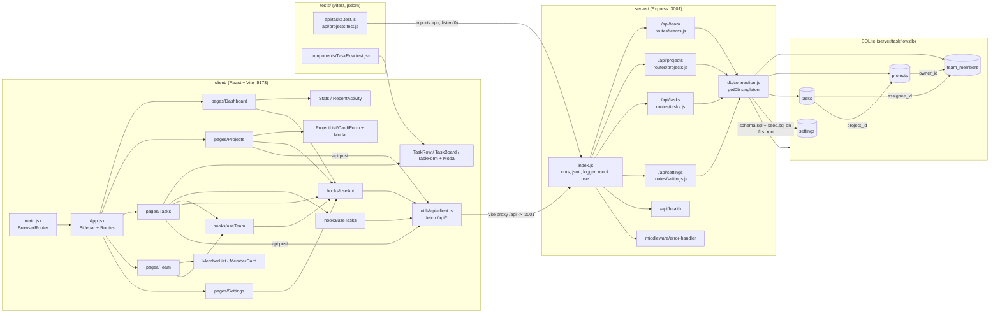

# Architecture Overview

TaskFlow is a B2B project management app. It's a plain-JavaScript (ES modules) monorepo with a React client, an Express REST API, and a SQLite database. There's no TypeScript, ORM, real auth, or CI.

Generated by `/explore-codebase`, which ran three parallel agents: Architecture Mapper, Tech Stack Summarizer, and UI Pattern Cataloger.

---

## System Architecture

### Layers

| Layer | Location | What it does |
|---|---|---|
| Client | `client/` | React 18 + React Router, served by Vite on :5173. `/api` requests are proxied to :3001. |
| Server | `server/` | Express on :3001. Middleware: cors, `express.json`, `middleware/logger.js`, a hardcoded mock user (`req.user`, id 1), and `middleware/error-handler.js`. |
| Database | `server/db/` | SQLite through better-sqlite3. `connection.js` exposes a lazy `getDb()` singleton (WAL mode, foreign keys on) and runs `schema.sql` + `seed.sql` on first run. |
| Tests | `tests/` | Vitest + jsdom. Two API test files and one component test. Coverage is thin on purpose. |

### How data flows

1. A page calls a hook: `useApi(endpoint)` for any GET, `useTasks(filters)` to build a task query string, or `useTeam()`, which is `useApi('/team')`.
2. The hook calls `utils/api-client.js` (`api.get/post/put/delete`), which wraps `fetch` with the `/api` prefix and JSON, and throws on any non-2xx response.
3. The Vite proxy sends `/api/*` to Express, and the matching router runs raw SQL through `getDb().prepare(...)`.
4. The JSON response returns to the hook, which sets `{ data, loading, error }`, and the page re-renders.
5. For creates (`POST /projects`, `POST /tasks`): the page calls `api.post`, closes the modal, then calls `refetch()`.

### Client routes (`client/src/App.jsx`)

| Path | Page | Main components |
|---|---|---|
| `/` | Dashboard | Stats, RecentActivity |
| `/projects` | Projects | ProjectList → ProjectCard, Modal + ProjectForm |
| `/tasks` | Tasks | TaskRow (list) / TaskBoard (board), Modal + TaskForm |
| `/team` | Team | MemberList → MemberCard |
| `/settings` | Settings | Toggle rows |

### API endpoints

| Router | Endpoints |
|---|---|
| `routes/teams.js` → `/api/team` | `GET /`, `GET /:id`, `GET /:id/tasks` |
| `routes/projects.js` → `/api/projects` | `GET /` (with `task_count`, `completed_count`), `GET /:id` (plus its tasks), `POST /`, `PUT /:id`, `DELETE /:id` (deletes the project's tasks first) |
| `routes/tasks.js` → `/api/tasks` | `GET /` (filters: `status`, `priority`, `assignee_id`, `project_id`; joins assignee and project names), `GET /:id`, `POST /`, `PUT /:id`, `DELETE /:id` |
| `routes/settings.js` → `/api/settings` | `GET /` (key/value), `PUT /` (upsert) |
| `index.js` | `GET /api/health` |

### Database tables (`server/db/schema.sql`)

| Table | Columns |
|---|---|
| `team_members` | id, name, role, email (unique), avatar_color, created_at |
| `projects` | id, name, description, status (`active`/`completed`/`on-hold`), owner_id → team_members, created_at, updated_at |
| `tasks` | id, title, description, status (`todo`/`in-progress`/`in-review`/`done`), priority (`low`/`medium`/`high`/`urgent`), assignee_id → team_members, project_id → projects, due_date, estimated_hours, created_at, updated_at |
| `settings` | key (PK), value |

---

## Tech Stack

| Package | Library | Version | Purpose |
|---|---|---|---|
| root | concurrently | ^8.2.2 | Runs the client and server together |
| root | vitest | ^1.6.0 | Test runner |
| root | @testing-library/react / jest-dom | ^15.0.7 / ^6.4.5 | Component testing |
| root | jsdom | ^24.1.0 | Simulated browser DOM for tests |
| client | react / react-dom | ^18.3.1 | UI |
| client | react-router-dom | ^6.23.1 | Page routing |
| client | vite + @vitejs/plugin-react | ^5.2.13 / ^4.3.0 | Dev server and bundler |
| server | express | ^4.19.2 | REST API |
| server | cors | ^2.8.5 | Cross-origin requests |
| server | better-sqlite3 | ^11.1.2 | Synchronous SQLite driver (raw SQL, no ORM) |

- **Styling:** plain CSS custom properties (`tokens.css`, `globals.css`) plus inline style objects. No UI library.
- **Build:** only the client has one (`vite build` → `dist/`). The server runs as plain Node.
- **No** TypeScript, ESLint, Prettier, or CI config. Each of the three `package.json` files gets its own `npm install` (no npm workspaces).

### Config files

| File | What it controls |
|---|---|
| `client/vite.config.js` | Port 5173, `/api` proxy to `localhost:3001`, plus an unused `test` block |
| `vitest.config.js` (root) | jsdom environment, `globals: true`, includes `tests/**/*.test.{js,jsx}`, setup file `client/src/test-setup.js` |
| `server/index.js` | Middleware, route mounts, mock user. Skips `listen` when `VITEST` is set and exports `app` |
| `server/db/connection.js` | DB file path, WAL mode, foreign keys, schema and seed on first run |

---

## UI Components & Design Patterns

### Styling conventions
- **Inline style objects** at module level, named `xxxStyle`. Styles that depend on a value are functions, e.g. `avatarStyle(color)` and `toggleStyle(active)`.
- Values come from CSS variables (`'var(--space-4)'`).
- Global classes in `styles/globals.css`: `.app-layout`, `.sidebar`, `.main-content`, `.page-header`, `.card`, `.form-group`.
- Hover is tracked with `useState`, because inline styles can't use `:hover`.
- **Naming:** components are PascalCase `.jsx` files with a default export. Hooks are `useX.js` with named exports. Utils are kebab-case. API data fields are snake_case, and enum values are kebab-case strings.

### Design tokens (`client/src/styles/tokens.css`)
- **Brand:** `--color-primary` (#e63f02) and `--color-accent` (#fcc403), each with `-hover` and `-light` variants.
- **Neutrals:** bg, surface, surface-hover, border, border-light, text, text-secondary, text-muted.
- **Status:** success, warning, error, info, each with a `-light` variant. **Priority:** urgent, high, medium, low.
- **Type:** Outfit; `--font-size-xs` through `3xl`; weights 300 to 700.
- **Spacing:** `--space-1` through `--space-16` (0.25rem steps).
- **Other:** `--border-radius-{sm,md,lg,full}`, `--shadow-{sm,md,lg}`, `--transition-{fast,base}`, `--sidebar-width` 240px.

### Reusable components

| Component | File | Props / notes |
|---|---|---|
| Button | `components/common/Button.jsx` | `variant` primary/secondary/ghost, `size` small, `disabled` |
| Modal | `components/common/Modal.jsx` | `isOpen`, `onClose`, `title`. Overlay click or × closes it, body scroll locks while open |
| Badge | `components/common/Badge.jsx` | `value`, a status/priority string mapped to pill colors |
| Spinner | `components/common/Spinner.jsx` | Three pulsing dots |
| Stats | `components/dashboard/Stats.jsx` | 4-column grid of stat cards (label + big number) |
| RecentActivity | `components/dashboard/RecentActivity.jsx` | List rows with a meta line and a status badge |
| ProjectCard / List / Form | `components/projects/` | Progress bar, auto-fill card grid, create form (edit mode exists but nothing uses it) |
| TaskRow / TaskBoard / TaskForm | `components/tasks/` | 5-column grid row, 4-column kanban, create-only form |
| MemberCard / MemberList | `components/team/` | Avatar with initials, auto-fill card grid |

### Patterns to reuse when building new features
- **Page skeleton:** call a hook, show `<Spinner />` while it loads, then `.page-header` (h1 + subtitle), then the content.
- **Create flow:** a `showForm` state, then `<Modal>` + `<XForm>`, then `api.post`, close the modal, and `refetch()`.
- **Stat card grid:** `Stats.jsx`. **Card grid with empty state:** `ProjectList` and `MemberList`.
- **List row with meta + badges:** `RecentActivity`, `TaskRow`.
- **Progress bar:** `ProjectCard`. **Avatar:** `MemberCard`. **Kanban:** `TaskBoard`. **Toggle row:** `Settings`.

---

## Known Gaps & Issues

- **Bugs:**
  - The Settings NavLink points to `/setting` but the route is `/settings` (`App.jsx`).
  - The label "Completd Tasks" is misspelled (`Stats.jsx`).
  - `ProjectList` uses `minmax(300px, 2fr)`.
- **Unfinished:**
  - Settings toggles have no handlers, and Dark Mode has no theme tokens.
  - `useTasks.updateTask`, ProjectForm's edit mode, and all PUT/DELETE endpoints have no UI.
  - `StatusBadge.jsx` is unused, and `estimated_hours` is collected but never displayed.
- **No UI error handling:** hooks return `error` but no page renders it, and the create handlers have no try/catch.
- **Token violations:** hardcoded colors in `Badge.jsx`, `#fff` in Button, MemberCard, and Settings, and an `rgba` overlay in Modal.
- **Accessibility:** Modal has no Escape key handling, no `role="dialog"`, and no focus trap.
- **Tests:** API tests write to the real dev database (`server/taskflow.db`).

---

## Key Files Reference

| File | Role |
|---|---|
| `client/src/main.jsx` | Client entry, wraps the app in BrowserRouter |
| `client/src/App.jsx` | Sidebar layout and route table |
| `client/src/utils/api-client.js` | Every HTTP call goes through here |
| `client/src/hooks/useApi.js` | Generic GET with `{data, loading, error, refetch}` |
| `client/src/hooks/useTasks.js` | Filtered task fetching plus `updateTask` |
| `client/src/styles/tokens.css` | Design system tokens |
| `client/src/pages/Tasks.jsx` | Most complex page: list/board views, filters, create modal |
| `server/index.js` | Express app, middleware, mock user, route mounts |
| `server/routes/tasks.js` | Task CRUD and filtering |
| `server/db/connection.js` | DB connection, schema and seed bootstrap |
| `server/db/schema.sql` | Table definitions |

---

## Development Workflow

| Task | Command |
|---|---|
| Install everything | `npm run install:all` |
| Run client + server | `npm run dev` (client :5173, server :3001) |
| Server only | `npm run dev:server` (`node --watch`) |
| Client only | `npm run dev:client` |
| Tests | `npm test` (root, `vitest run`) |
| Production build | `cd client && npm run build` |
| Reset the database | `cd server && npm run db:reset` (deletes `taskflow.db`; it's rebuilt on next server start) |
