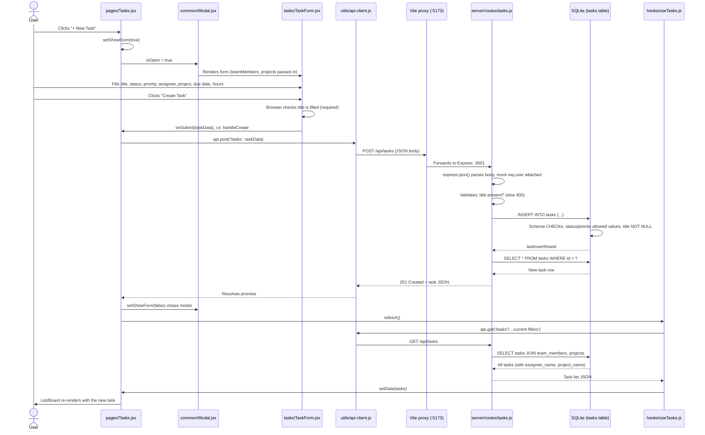

# Task Creation Flow

How a task gets created in TaskFlow, from the moment the user clicks "+ New Task" on the Tasks page to the moment the new task appears in the list.

## Sequence diagram

## Step by step

| # | Layer | File | What happens |
|---|---|---|---|
| 1 | UI | `client/src/pages/Tasks.jsx` | User clicks **+ New Task**, which sets `showForm` to `true`. |
| 2 | UI | `client/src/components/common/Modal.jsx` | The modal opens with the title "New Task". |
| 3 | UI | `client/src/components/tasks/TaskForm.jsx` | The form renders. The assignee and project dropdowns are filled from data the page already fetched (`useTeam`, `useApi('/projects')`). Each field is held in its own piece of state. |
| 4 | UI validation | `TaskForm.jsx` | On **Create Task**, the browser blocks submission if the title is empty (the `required` attribute). The form packages the fields into an object, converting empty selects to `null` and empty hours to `0`. |
| 5 | Page logic | `Tasks.jsx` → `handleCreate` | Calls `api.post('/tasks', taskData)`. |
| 6 | Network | `client/src/utils/api-client.js` | Adds the `/api` prefix, converts the body to JSON, and sends a `POST /api/tasks`. Throws an error on any non-2xx response. |
| 7 | Network | `client/vite.config.js` | The Vite dev server proxies `/api` to Express on port 3001. |
| 8 | Server | `server/index.js` | Middleware parses the JSON, logs the request, and attaches the mock user. Then it routes to the tasks router. |
| 9 | Server validation | `server/routes/tasks.js` (`POST /`) | Returns **400 "Title is required"** if there's no title. Fills in defaults: status `todo`, priority `medium`. |
| 10 | Database | `server/db/schema.sql` | `INSERT INTO tasks`. The schema enforces `title NOT NULL` and limits status and priority to their allowed values. |
| 11 | Server | `tasks.js` | Reads the new row back and responds **201 Created** with the task. |
| 12 | Page logic | `Tasks.jsx` | Closes the modal, then calls `refetch()`. |
| 13 | Data refresh | `client/src/hooks/useTasks.js` | Re-runs `GET /api/tasks` with the current filters. The server joins in assignee and project names. |
| 14 | UI | `Tasks.jsx` → `TaskRow` / `TaskBoard` | The list or board re-renders, and the new task appears in due-date order. |

## Validation happens at three levels

1. **Browser:** the title field is `required`.
2. **API route:** rejects a request with no title (400).
3. **Database:** `NOT NULL` on title, plus `CHECK` constraints on status and priority.

## Weak spots worth knowing

- **Failures are silent.** `handleCreate` has no `try/catch`. If the POST fails (server down, 400, or a CHECK violation), the modal stays open and the user sees no error message.
- **The page flashes.** `refetch()` sets `loading = true`, and `Tasks.jsx` replaces the whole page with `<Spinner />` while loading. So after every create, the page briefly blanks out.
- **The new task might not appear.** The refetch respects active filters. If the list is filtered (e.g. Status = Done) and the new task is `todo`, it saves fine but doesn't show up. That could look like a bug to a user.
- **The response isn't used.** The POST returns the created task, but the page ignores it and re-downloads the entire list instead.
- **No tests for the create flow from the UI.** `tests/api/` covers POST for projects, but not for tasks.
